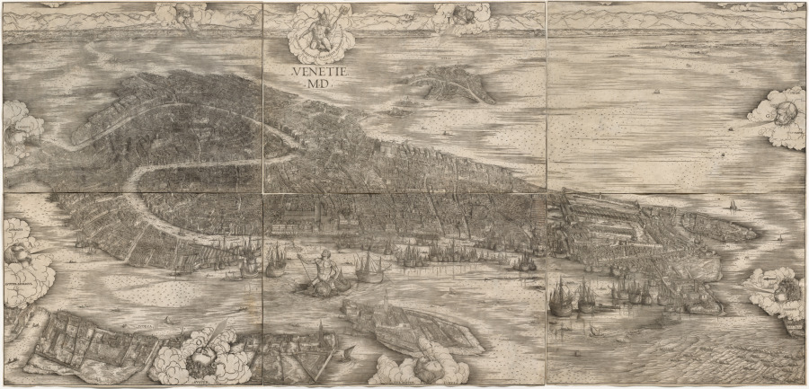

# Hi, I'm Antonio Perazza 👋

I'm studying Economics, Management and Computer Science at Bocconi University. My main interest is statistics: how we build models from imperfect observations, quantify uncertainty, and decide what the evidence supports.

Reading David Spiegelhalter's *The Art of Statistics* alongside my first statistics course made me curious about how simple probability models can describe complicated events. Since then, I've become especially interested in Bayesian inference, Monte Carlo methods, and the assumptions behind prediction and model comparison.

## 🔬 Selected projects

**[Reservoir computing and human brain networks](https://github.com/bs-machinelearning/reservoir-computing-research)**  
Student team research supervised by Dr Victor Buendía. I compared Gaussian and human-connectome reservoirs for Lorenz-system prediction using ridge regression, and contributed to experiments on structural perturbations. The project made me more attentive to how experimental design affects a comparison between models.

**[The 2D Ising model](https://github.com/paranza/ising-problem)**  
A course project using Metropolis MCMC to study energy, magnetization, and clusters across temperatures. My planned extension focuses on autocorrelation, effective sample size, and uncertainty in simulation estimates: how much information do the retained samples actually contain?

**[Family size and labour supply](https://github.com/paranza/Family-Size-and-Labor-Supply-Replication-and-Extension-of-Angrist-and-Evans-1998)**  
An R replication project based on Angrist and Evans (1998), with an extension using a control-function probit and bootstrap marginal effects. It explores instrumental variables and the additional assumptions involved in moving to a nonlinear model.

**[Pictures made from thread](https://github.com/paranza/image-stylization-threading)**  
A browser tool that turns images into string art through greedy optimisation. A side project connecting algorithms with drawing, colour, and the practical constraints of making something by hand.

## 📊 Statistics in practice

At a startup, I developed conversion forecasts using Beta distributions and Monte Carlo simulation. Recent leads had not yet had enough time to convert, so I used older cohorts' timing patterns to adjust for incomplete observation and tested forecasts on held-out cohorts. Limited mature data made reliability difficult to establish. That experience is behind my interest in how assumptions about the observation process affect both predictions and their uncertainty.

I work with **Python, R, and SQL**, and use **Git and LaTeX** for code and reports.

I work with **Python, R, and SQL**, and use **Git and LaTeX** for code and reports.

## 🚵 Away from the screen 𓄂𓆃

I enjoy mountain biking, gravel riding, and spending time in nature.

My historical rabbit hole is the Venetian Republic, particularly its banking, public debt, and political institutions. My reading interests range from Alvise Zorzi's *La Repubblica del Leone* to Reinhold C. Mueller's *The Venetian Money Market* and Gasparo Contarini's *De magistratibus et republica Venetorum*. Medieval banking panics and the machinery of Venetian government are topics I'm happy to get sidetracked by.

*Jacopo de' Barbari, View of Venice (1500), published by Anton Kolb. Woodcut from six blocks. [Cleveland Museum of Art](https://www.clevelandart.org/art/1949.565), public domain (CC0).*

[LinkedIn](https://www.linkedin.com/in/antonioperazza)
